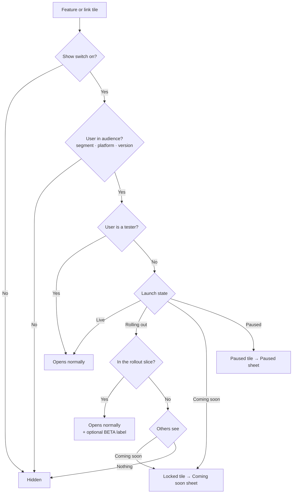
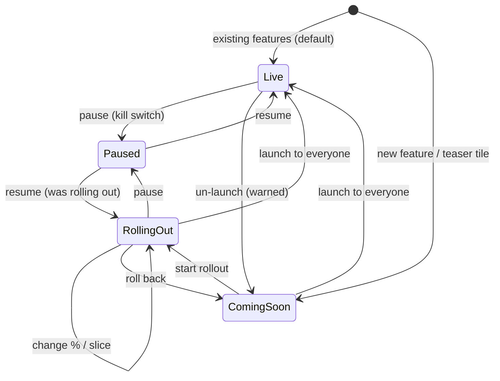

# Launch states: "Coming soon", partial launches and pauses

**Status:** Implemented (v1 + v1.1) on `feat/launch-states` in the CMS, backend and app
**Owner:** App CMS
**Date:** 27 Sep 2026
**Touches:** CMS (`Screens & features`, `Overview`, new `Launches` page), backend (`/api/cms/features`, `/api/app-config`), app (`lib/appConfig.ts`, tile rendering, route guard)

---

## 1. The problem

Today every feature in the CMS has two controls: a **Show** switch and **Who sees it** (audience). A feature is either fully on for its audience or it's gone. That covers "hide it" and "premium only", but not the moments the team actually runs into:

| Moment | What we want | What we can do today |
|---|---|---|
| A feature is built and shipped in the app, but we're not ready to launch | Tease it: users see the tile with a "Soon" label and can't open it | Hide it. Nobody knows it's coming |
| We want to build hype before a launch | Collect "Notify me" interest, show a date | Nothing |
| We want 10% of users (or only Android, or only premium) to get it first | Gradual rollout, while everyone else sees "Coming soon" | Audience targeting, but everyone outside it sees *nothing*, and there's no percentage |
| QA or staff need to test a feature in production before launch | Only testers can open it | Nothing safe: the audience options are all public groups |
| A live feature breaks (the consultation provider is down, say) | Keep the tile, show "Taking a short break, back soon" | Hide it, which looks like we removed it. Or turn on maintenance mode, which blocks the whole app |
| A banner or link points to a feature that's not open | The link lands on a friendly "Coming soon" screen | The link opens a half-ready screen, or a blank one |

**Goal:** give staff one clear place to say, for each feature, *who can use it right now, and what everyone else sees*, without an app release.

**Not the goal:** a general A/B testing or experimentation platform. We're not measuring variants against each other. This is launch management.

---

## 2. The core idea

One question per feature:

> **Who can use it right now, and what does everyone else see?**

That question gives us four **launch states**. They sit *on top of* the existing Show switch and audience; they don't replace them.

| State | Who can use it | Everyone else in the audience sees | Pill in CMS | Label in app |
|---|---|---|---|---|
| **Coming soon** | Testers only | A locked tile. Tapping it opens the Coming soon sheet | `SOON` amber | `SOON` |
| **Rolling out** | A slice: a % of users, and/or a segment, platform or version, plus testers | Coming soon tile, **or** nothing (staff choose) | `ROLLOUT 25%` violet | `BETA` (optional) for those who have it |
| **Live** | Everyone in the audience | — | none | none, or the normal badge |
| **Paused** | Nobody (testers still can) | The tile, marked paused. Tapping it opens the Paused sheet | `PAUSED` red | small pause dot |

Existing features default to **Live**, so nothing changes for users on day one.

### How the layers stack

Visibility is decided in this order. The first rule that matches wins.



Why layer it instead of merging everything into one big "availability" control:

- **Audience** answers *who is this feature for*: "premium only", "Android only, because the iOS build doesn't have it". That's a long-lived product decision.
- **Launch state** answers *where are we in launching it*. That's temporary, and it moves forward over days or weeks.
- Keeping them apart means you can take a premium-only feature through Coming soon, Rolling out and Live without touching its audience, and "Pause" never loses the audience you set.

---

## 3. Lifecycle



Rules:

- **Paused remembers where it came from.** Resume goes back to the exact previous state, including the rollout %.
- **Moving backwards is allowed but warned.** Live → Coming soon takes a feature away from people who were using it. The CMS says so and asks for confirmation.
- **Launch to everyone** is the only transition that gets a confirmation dialog on the way *forward*, because it's the one you can't quietly undo.
- **Show off (hidden) still wins over everything.** Launch state is kept while hidden, so turning Show back on restores it.

---

## 4. What users see in the app

### 4.1 Tiles

| State | Tile | Accessibility label |
|---|---|---|
| Coming soon | Normal icon and colour at ~55% opacity. The `SOON` pill replaces any custom badge. No chevron on large rows | "{Title}, coming soon" |
| Rolling out (in slice) | Normal tile. `BETA` pill only if staff tick "Show Beta label" | "{Title}, beta" |
| Rolling out (not in slice) | Same as Coming soon, or not shown | — |
| Live | Unchanged | Unchanged |
| Paused | Normal look plus a small pause dot in the corner. Custom badge hidden | "{Title}, temporarily unavailable" |

A locked tile must still look tappable. People will tap it, and that tap is the moment we want: it's where we tell them what's coming and invite them to join the list.

### 4.2 Coming soon sheet

Tapping a Coming soon tile opens a bottom sheet (not a full screen, since there's nothing to navigate to):

```
┌─────────────────────────────────────┐
│               ───                   │
│                                     │
│            [ tile icon ]            │
│                                     │
│        Ask a Gynae, 24×7            │  ← feature title
│          Coming soon                │  ← or "Coming in October"
│                                     │
│   Chat with a certified gynae any   │  ← staff message (≤ 160 chars)
│   time, day or night.               │
│                                     │
│  ┌───────────────────────────────┐  │
│  │        🔔  Notify me          │  │  ← only if Notify me is on
│  └───────────────────────────────┘  │
│           Maybe later               │
└─────────────────────────────────────┘
```

After tapping **Notify me**, the button changes to **"✓ You're on the list"** and stays that way on later visits. A signed-out user can still join: we store it against the device, and move it to their account when they sign in.

### 4.3 Paused sheet

```
┌─────────────────────────────────────┐
│            [ tile icon ]            │
│      Consultations are paused       │  ← staff title
│                                     │
│   We're fixing a problem with       │
│   bookings. Back by 6 pm today.     │  ← staff message
│                                     │
│  ┌───────────────────────────────┐  │
│  │   Chat with us on WhatsApp    │  │  ← optional alternative action
│  └───────────────────────────────┘  │
│               OK                    │
└─────────────────────────────────────┘
```

The alternative action reuses the existing tap-action editor (screen, website or other app), so staff can send people somewhere useful while the feature is down.

### 4.4 Deep links and route guard

Banners, link tiles, pop-ups, push notifications and old shared links can all point at a route like `/consultation`. If that feature isn't open to this user, the app's router **intercepts the navigation** and shows the same sheet instead of the screen.

This is the most important piece for safety. Without it, a stale banner is a back door into a half-finished feature.

---

## 5. CMS design

### 5.1 In `Screens & features` (where editing happens)

**Row:** a state pill after the title, so the column shows launch status at a glance:

```
⋮⋮ ↑↓  Ask a Gynae 24×7   SOON          ●━━  ⌄
        Grid tile · Rose · 🔔 1,284 waiting
⋮⋮ ↑↓  Symptom checker    ROLLOUT 25%   ●━━  ⌄
        Large row · Violet · Android · Premium
⋮⋮ ↑↓  Consultation       PAUSED        ●━━  ⌄
        Grid tile · Mint · paused 2 h ago
```

**Editor:** a new **Launch** fieldset, placed *above* "Who sees it", because it's the control people will reach for most often during a launch:

```
┌ Launch ─────────────────────────────────────────────────┐
│  [ Coming soon | Rolling out | Live | Paused ]          │
│                                                         │
│  ── when Coming soon ──                                 │
│  Headline        [ Coming soon            ▾ ]           │
│                    Coming soon / Coming this month /    │
│                    Coming next month / Custom…          │
│  Message         [ Chat with a certified gynae…    ]    │
│  ☑ Let people tap “Notify me”        1,284 waiting      │
│  Go live on      [ date  time ]  (optional)             │
│                                                         │
│  ── when Rolling out ──                                 │
│  Give it to      [━━━━━●──────────] 25% of users        │
│                   5 · 10 · 25 · 50 · 100 quick steps    │
│  Only for        [ Everyone in audience ▾ ] [Android]   │
│  Everyone else   (•) sees Coming soon   ( ) sees nothing│
│  ☐ Show a BETA label to people who have it              │
│                                                         │
│  ── when Paused ──                                      │
│  Title           [ Consultations are paused       ]     │
│  Message         [ We're fixing a problem…        ]     │
│  Instead, offer  [ tap-action editor              ]     │
│  Resume on       [ date  time ]  (optional)             │
│                                                         │
│  Testers         [ priya@thenura.care, +2 ]  ⓘ always   │
│                   get it, in every state                │
└─────────────────────────────────────────────────────────┘
```

**Quick recipes** sit above the segmented control as one-click starting points. They only fill in the fields; the user still saves:

- **Tease it:** Coming soon, Notify me on
- **Staff test:** Coming soon, testers only, Notify me off
- **Android first:** Rolling out 100% on Android, everyone else sees Coming soon
- **Premium early access:** Rolling out to Premium, with a BETA label
- **Pause it:** Paused, with the default message

**Preview:** the phone preview gets a **Preview as** toggle: *Has access* / *Everyone else*. That lets staff see the locked tile, and tap it to see the sheet, before publishing. Saving works exactly as it does now: through the save bar, with conflict protection and a History entry.

**Link tiles** get the same Launch fieldset. A link tile with the action "Nothing (info only)" in the Coming soon state is how staff announce something **that isn't in the app yet at all** (a new service, an event). No code needed.

### 5.2 New page: `Launches` (the control room)

Screens & features is organised by *where* things are. During a launch, people think in terms of *what's in flight*. The Launches page lists every item that isn't plainly Live, grouped by state:

```
Launches                                             [ + Tease a feature ]
What's coming, rolling out or paused across the app.

COMING SOON (2)
┌─────────────────────────────────────────────────────────────────────┐
│ Ask a Gynae 24×7     Care hub   🔔 1,284 waiting   Go live 1 Oct    │
│                                         [ Start rollout ] [ Launch ]│
├─────────────────────────────────────────────────────────────────────┤
│ Nura Retreats (link) Home       🔔 212 waiting     ⚠ No date set    │
└─────────────────────────────────────────────────────────────────────┘

ROLLING OUT (1)
┌─────────────────────────────────────────────────────────────────────┐
│ Symptom checker      Wellness   25% · Android · Premium  since 3 d  │
│         [ 5 ][ 10 ][●25 ][ 50 ][ 100 ]        [ Pause ] [ Launch ]  │
└─────────────────────────────────────────────────────────────────────┘

PAUSED (1)
┌─────────────────────────────────────────────────────────────────────┐
│ Consultation         Care hub   paused 2 h ago by Utkarsh           │
│   ⚠ 1 live banner links here                           [ Resume ]   │
└─────────────────────────────────────────────────────────────────────┘

RECENTLY LAUNCHED (last 14 days)
  Habits · launched 20 Sep by Priya · went 10% → 50% → 100% over 6 days
```

- Quick actions (Launch, Pause, Resume, the % buttons) publish **immediately** after a small confirm. This page is for fast moves during an incident or a launch day.
- Detailed editing (message, testers, schedule) links through to the item in Screens & features. **One source of truth, one editor.**

### 5.3 `Overview`

A fifth stat card, **Launches**: "2 coming soon · 1 rolling out · 1 paused", with total Notify me signups. If anything is **Paused**, it also gets a red notice, just like maintenance mode, so no one forgets a feature is switched off.

### 5.4 Warnings and guardrails

| Situation | Where it shows | Severity |
|---|---|---|
| A live banner or link tile opens a route that's Coming soon or Paused for some users | Feature editor, Launches, Banner editor | Warning (the route guard keeps it safe; this is about wasting ad space) |
| The "Go live on" date has passed but the state is still Coming soon (the schedule was removed or failed) | Launches, Overview | Warning |
| Paused for more than 48 h | Launches, Overview | Warning |
| Rolling out for more than 30 days | Launches | Nudge: "Launch it or roll it back?" |
| Live → Coming soon, or lowering the rollout % | Confirm dialog | "People who already use it will lose access" |
| Launch to everyone | Confirm dialog | Shows the feature name and audience |
| Coming soon with no message | Inline | Uses the default copy; not blocked |
| Feature needs a newer app than the audience's minimum version | Inline | See §7, old builds |

---

## 6. Decisions

| # | Decision | Options considered | Chosen | Why |
|---|---|---|---|---|
| D1 | Separate launch state from audience, or merge them? | Merge into one "availability" control / keep separate | **Separate, layered** | Audience is a long-lived product decision; launch state is temporary. Pausing or rolling back must never wipe targeting |
| D2 | How many states? | 2 (on/soon) / 4 / 6 (+ beta, sunset, draft) | **4** | Beta is just "Rolling out + label". Sunset is rare and a banner covers it. Draft is the same as Hidden. Fewer states are easier to learn |
| D3 | What does a Coming soon tap do? | Nothing / toast / bottom sheet / full screen | **Bottom sheet** | A toast is too small for a message and a Notify me button. A full screen suggests there's somewhere to go. The sheet is dismissible and says enough |
| D4 | Exact ETA dates? | Exact date / coarse label / none | **Coarse label by default** ("Coming this month"), exact date optional via Custom | Launch dates slip. "Coming 1 Oct", then still locked on 3 Oct, breaks trust. The schedule date stays internal |
| D5 | How is the rollout % assigned? | Random per launch / sticky hash | **Sticky:** `hash(featureKey + userId‖deviceId) mod 100` | The same person stays in or out between app opens, and raising 10% → 25% only adds people, never swaps them. Hashing per feature means the same 10% don't get every beta |
| D6 | Where is access decided? | App / backend / both | **Backend decides, app enforces** | The backend knows the user, can hash stably and keeps tester lists private. The app renders the result and runs the route guard. See §7 |
| D7 | Tester identity | Emails / user IDs / a "staff" segment | **App user emails or phone numbers, typed in the CMS, resolved to user IDs on save** | Staff think in emails; IDs survive a changed email. Max ~50 per feature |
| D8 | Where do people edit? | Only Screens & features / only a new page / both | **Edit in Screens & features; the Launches page offers quick actions only** | Avoids two editors for the same data, while still giving a focused launch-day view |
| D9 | Quick actions: draft or instant? | Draft + save bar / instant | **Instant, with a confirm** | Pausing during an incident can't wait behind a save bar. Each quick action is still a normal publish, with History and conflict checks |
| D10 | Notify me for signed-out users | Require sign-in / device-based | **Device-based, merged into the account on sign-in** | Asking for sign-in on a teaser kills the conversion. Device IDs are good enough for a count and a push |
| D11 | Does Paused hide the tile? | Hide / keep with a notice | **Keep with a notice** (the Hidden switch is still there if you want it gone) | A tile that vanishes looks like we removed the feature and generates support tickets |
| D12 | Scope for v1 | Features + link tiles / + Home sections / + banners | **Features and link tiles** | That's where "coming soon" lives in the UI. Home sections and banners already have show/schedule controls |

---

## 7. How it's wired (the contract)

This is the exact shape all three repos build against. "Item" means a built-in feature or a link tile. An item's **item key** is the feature `key` (`consultation`), or `link:<tileId>` for a link tile.

### 7.1 Stored config: CMS ⇄ backend (`GET /api/cms/config`, `PUT /api/cms/features`)

Every feature and every link tile carries a full `launch` object. The backend always returns every field, filling in defaults, so an item saved before this feature existed reads as `DEFAULT_LAUNCH` (Live).

```ts
type LaunchState = "live" | "coming_soon" | "rolling_out" | "paused";
type LaunchHeadline = "soon" | "this_month" | "next_month" | "custom";

type Launch = {
  state: LaunchState;
  /** Set while paused: what Resume goes back to. Ignored otherwise. */
  resumeTo: "live" | "rolling_out";
  rollout: {
    percent: number;                    // integer 0–100 (sticky buckets, see 7.3)
    audience: Audience;                 // slice limit, same shape as item.audience; EVERYONE = no limit
    othersSee: "coming_soon" | "hidden";
    betaLabel: boolean;
  };
  soon: {
    headline: LaunchHeadline;
    customHeadline: string | null;      // ≤ 40 chars, required when headline = "custom"
    message: string | null;             // ≤ 160 chars; null = the app shows the tile description
    notifyMe: boolean;
    goLiveAt: string | null;            // ISO; must be in the future when saved; coming_soon / rolling_out only
  };
  paused: {
    title: string | null;               // ≤ 60 chars; null = "Taking a short break"
    message: string | null;             // ≤ 200 chars; null = default copy
    alternative: TapAction;             // type "none" allowed (no button)
    alternativeLabel: string | null;    // ≤ 24 chars; null = "Go there instead" / "Get help another way"
    resumeAt: string | null;            // ISO; must be in the future when saved; paused only
  };
  /** Always get the feature, in every state. Max 50. */
  testers: { id: string; label: string }[];
  /** Server-set: when `state` last changed. Read-only for the CMS. */
  since: string | null;
};
```

**Teaser tiles.** A link tile's tap action may be `none` (the CMS calls it "Nothing"). That's how you tease something that isn't in the app yet. It's only allowed while the tile is `coming_soon` with no `goLiveAt`: anything else gets `400 "… needs a tap action before it can go live"`. The app never shows a no-action tile as open.

**Saving testers.** In `PUT /api/cms/features`, `launch.testers` is a list of **strings**. Each one is an app user id (24 hex characters, sent back unchanged for testers who were already resolved), an email address, or a phone number. The backend resolves each string to a user, and responds with `400 "No app user with the email or phone …"` if it can't find one. `label` is the user's email, then phone, then name.

**Defaults** (`DEFAULT_LAUNCH`): state `live`, resumeTo `live`, rollout `{ percent: 10, audience: EVERYONE, othersSee: "coming_soon", betaLabel: false }`, soon `{ headline: "soon", customHeadline: null, message: null, notifyMe: true, goLiveAt: null }`, paused `{ title: null, message: null, alternative: none, alternativeLabel: null, resumeAt: null }`, testers `[]`, since `null`.

**Schedules.** A backend runner checks once a minute. It moves a `coming_soon` or `rolling_out` item whose `goLiveAt` has passed to `live`, and a `paused` item whose `resumeAt` has passed back to `resumeTo`. It clears the date it acted on and publishes a normal revision with the note "Scheduled: …". Access is also worked out against `now` on every fetch, so a launch never waits for the next tick.

### 7.2 Launch stats for the CMS

| Endpoint | Permission | Returns |
|---|---|---|
| `GET /api/cms/launches` | cms.read | `{ stats: { [itemKey]: { waiting, toNotify, deviceOnly, lastNotifiedAt, lockedTaps } } }` (only item keys that have data). `toNotify` = sign-ups with an account that haven't had the "It's here" push yet; `deviceOnly` = signed-out sign-ups, which a push can't reach |
| `POST /api/cms/launches/:itemKey/announce` | cms.manage | Body `{ title, body }`. Only for a live item. Pushes "It's here" to its `toNotify` people, up to 5000 per send, through the Admin Workspace broadcast worker (push + in-app inbox, opening the feature). Returns `202 { broadcastId, recipients, withPush, remaining }` |
| `GET /api/cms/launches/:itemKey/waitlist` | cms.manage | `{ entries: [{ createdAt, platform: "android"\|"ios"\|"web"\|null, user: { _id, firstName?, lastName?, email?, phone? } \| null }] }`, newest first, max 5000. The CMS turns this into a CSV file |

The Launches page's quick actions (Launch, Pause, Resume, change %) are ordinary `PUT /api/cms/features` saves of the whole list, with that one item changed.

### 7.3 What the app receives (`GET /api/app-config`)

**Request.** The app now sends:

- `Authorization: Bearer <token>` when signed in (the endpoint uses `optionalAuth`, so a bad token is simply ignored)
- `X-Device-Id: <uuid>`: a random id made on first launch and kept in AsyncStorage (`/^[A-Za-z0-9-]{8,64}$/`)
- `X-Nura-Launch: 1`: "I understand `launch`"

**Response.** Each feature and link tile keeps its current fields and gains:

```ts
launch: {
  access: "open" | "soon" | "paused";
  beta: boolean;                    // show a BETA pill (only when access = "open")
  openFor: Audience | null;         // open only for viewers matching this; everyone else gets `fallback`
  fallback: "soon" | "hidden";
  sheet: {
    headline: string;               // "Coming soon" / "Coming this month" / "Coming next month" / custom; paused title for paused
    message: string | null;
    notifyMe: boolean;
    onList: boolean;                // this user/device already tapped Notify me
    alternative: TapAction;         // paused only; type "none" = no button
    alternativeLabel: string | null; // paused only
  };
}
```

**How the backend decides**, per item, for this user or device. The first rule that matches wins:

1. The user is a tester → `open`.
2. `live` → `open`.
3. `coming_soon` → `soon`.
4. `paused` → `paused`.
5. `rolling_out`:
   - The user is in the percentage when `percent ≥ 100`, or when `bucket < percent`, where `bucket = parseInt(sha256(itemKey + ":" + (userId ?? deviceId)).slice(0, 8), 16) % 100`. With no id at all, the user is out unless the rollout is at 100%.
   - In the percentage → `open`, with `beta = betaLabel`, `openFor = rollout.audience` (or `null` when it's EVERYONE), and `fallback` = `othersSee` (`coming_soon` becomes `"soon"`, `hidden` becomes `"hidden"`).
   - Outside it, with othersSee `hidden` → the item is sent with `enabled: false`. It still carries a `soon` launch, with `notifyMe` off, so the app's route guard keeps stale links out of the screen.
   - Outside it, with othersSee `coming_soon` → `soon`.

A `goLiveAt` or `resumeAt` that has already passed counts as having happened.

**What the app decides**, after its usual `enabled` and `audience` checks:

- If `access = "open"` and `openFor` is set and the viewer doesn't match it, use `fallback`: `"soon"` or `"hidden"`.
- `open` → the tile works as it does today, plus a BETA pill when `beta` is true.
- `soon` → a locked tile with a SOON pill. A tap opens the Coming soon sheet and sends the tap beacon.
- `paused` → a tile with a pause dot. A tap opens the Paused sheet.
- **Route guard:** any in-app navigation from a CMS tap action (banner, pop-up, link tile) or a push notification to a route whose feature is `soon` or `paused` for this viewer opens the sheet instead. A route belongs to a feature when its path, without the `/(app)` group and the query string, equals the feature route's path or starts with it followed by `/`.

**Old builds.** A request without `X-Nura-Launch: 1` gets no `launch` fields. Every item that isn't plainly `open` for that request (`soon`, `paused`, or `open` with `openFor` set) is sent with `enabled: false`, so an old build never shows something unfinished.

**Caching.** `Cache-Control: private, no-cache` and `Vary: Authorization, X-Device-Id, X-Nura-Launch`. The app refetches the config after sign-in and sign-out.

### 7.4 App → backend beacons (public, `optionalAuth`, `X-Device-Id`)

| Endpoint | Does |
|---|---|
| `POST /api/app-config/launch/:itemKey/notify` | Joins the Notify me list, merging a device-only entry into the account once signed in. Returns `{ onList: true }`. Returns `400` unless the item is `coming_soon` or `rolling_out` with `notifyMe` on |
| `POST /api/app-config/launch/:itemKey/tap` | Counts one locked tap (fire-and-forget) |

`itemKey` is URL-encoded, so `link:abc123` is sent as `link%3Aabc123`.

## 8. Metrics we show

Kept deliberately small. This isn't an analytics product.

- **Notify me signups** per feature (count, plus a CSV export for the marketing team)
- **Locked taps:** how many times people tapped a Coming soon tile. It's the cheapest demand signal we have, and it's worth having even with Notify me off
- **Rollout history:** a timeline of state and % changes, taken from History

We don't show crash rates or engagement per rollout slice. That belongs in the analytics tool, and the CMS could link out to it later.

---

## 9. Phasing

| Phase | Scope |
|---|---|
| **v1: Launch states** | Four states on features and link tiles, testers, Coming soon / Paused sheets, route guard, Launch fieldset + recipes, "Preview as", row pills, Overview card, old-build safety |
| **v1.1: Demand & schedule** | Notify me (device + account), signup counts + CSV, locked-tap counts, Go live on / Resume on schedules, Launches page |
| **v2: Close the loop** | ✅ Push "It's here" to the Notify me list at launch (Launches page → *Tell N it's here*); ✅ banner editor warnings. Still to do: launch states on Home sections, a "Launch" banner template |

Launches page could move to v1 if we expect to run a rollout immediately. It's mostly a filtered view of data v1 already has.

---

## 10. Open questions for the implementation discussion

1. **Does `/api/app-config` already identify the user and device** well enough for sticky rollout hashing and per-user caching? If it's cached today, what's the cache key?
2. **Which app version ships the launch-state support?** That becomes the cut-off for the old-build `enabled: false` downgrade.
3. **Push notifications:** does period-buddy-be have push (Expo push tokens) today? That decides whether "notify on launch" is v2 or v1.1.
4. **Testers:** type app-user emails/phones in the CMS (D7), or add a "Tester" flag to users in the Admin Workspace and reuse it everywhere?
5. **Route guard coverage:** which routes map to which feature key? The feature list has a `route` for each built-in, but sub-routes (`/consultation/book/…`) need a prefix rule.
6. **Permissions:** should Pause be available to `cms.read` roles (on-call support) as an emergency action, while everything else needs `cms.manage`?
7. **Copy:** the default Coming soon and Paused messages, in the app's voice (and in Hindi, if the app is localised).
